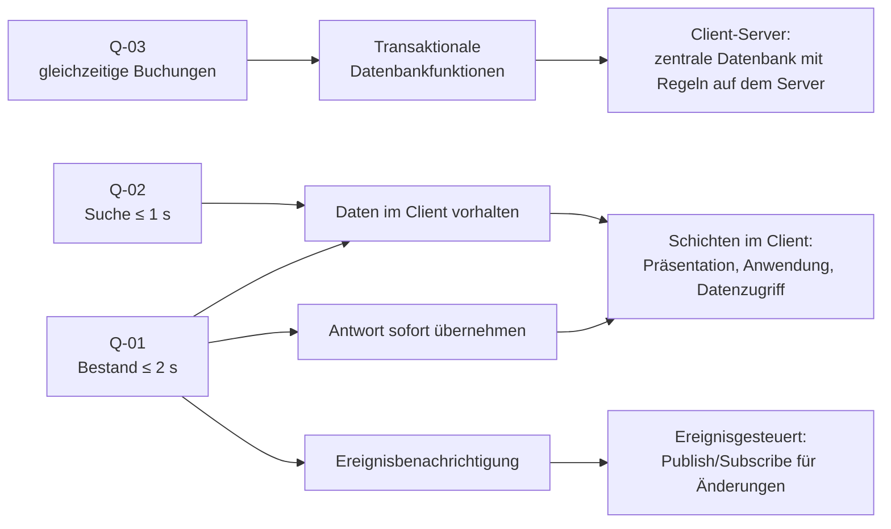
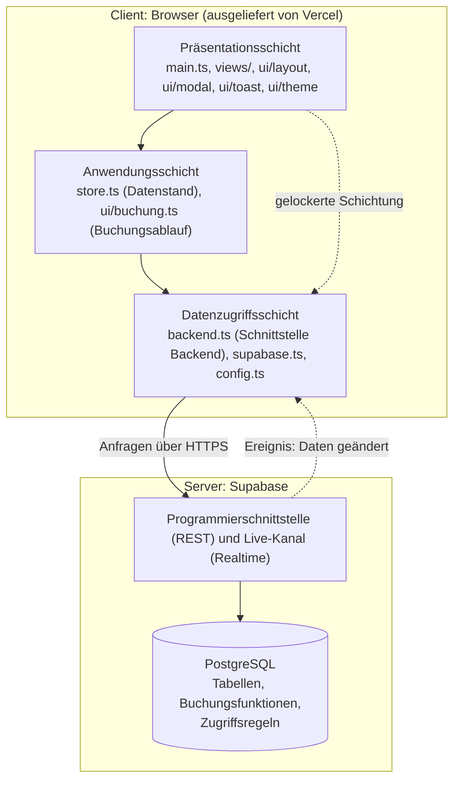

# Architekturstil

**Produkt:** Teilelager – Lager und Verkauf für die Werkstatt
**Stand:** 27.11.2026 (Entwurf, am Quellcode geprüft)
**Issue:** #6

Der Architekturstil wird nach **Attribute-Driven Design (ADD)** hergeleitet, wie in der Vorlesung vorgestellt: Das Muster wird nicht zuerst gewählt und danach begründet, sondern folgt aus Qualitätsszenarien und Taktiken. Voraussetzungen sind erfüllt: Ziele, funktionale Anforderungen, Qualitätsanforderungen und Randbedingungen liegen in `docs/requirements/` vor, die Qualitätsszenarien in `qualitaetsszenarien.md`.

## 1 Herleitung mit ADD

### Schritt 1: Modul wählen

Gewählt wird das Modul **Buchung und Bestand**. Es ist der qualitätskritischste Teil des Systems: Jeder Verkauf, jede Lieferung und jede Korrektur ändert den Bestand, und ein falscher Bestand macht die Lagerübersicht wertlos.

### Schritt 2: Qualitätsszenarien

| ID | Qualitätsattribut | Szenario mit Metrik |
|---|---|---|
| Q-03 | Zuverlässigkeit (Integrität) | Zwei Geräte buchen gleichzeitig auf dasselbe Teil. Metrik: Endbestand = Summe aller Buchungen in 100 % der Fälle; 0 verlorene Buchungen. |
| Q-01 | Performance (Zeitverhalten) | Der Inhaber trägt einen Verkauf ein. Metrik: Neuer Bestand ist bei 95 % der Buchungen nach ≤ 2 s sichtbar. |
| Q-02 | Performance (Zeitverhalten) | Der Inhaber sucht ein Teil. Metrik: Treffer nach ≤ 1 s bei 1.000 Teilen. |

### Schritt 3: Taktiken wählen

| Szenario | Taktik | Kategorie (ISO/IEC 25010) |
|---|---|---|
| Q-03 | Bestand ausschließlich über **transaktionale Datenbankfunktionen** ändern: Jede Buchung ist ein einzelner, atomarer Schritt in der Datenbank mit Zeilensperre. Direktes Schreiben des Bestands ist durch die Zugriffsregeln verboten (Datenbank-Constraints). | Sicherheit / Zuverlässigkeit: Integrität |
| Q-01 | **Antwort der Buchung sofort übernehmen:** Die Datenbankfunktion liefert den neuen Bestand zurück; der Client zeigt ihn ohne weitere Anfrage an. | Effizienz: Zeitverhalten |
| Q-01, Q-02 | **Daten im Client vorhalten (Caching):** Kategorien und Teile liegen nach dem Laden im Speicher des Clients; Suche und Filter laufen dort. | Effizienz: Zeitverhalten |
| Q-01 (zweites Gerät) | **Ereignisbenachrichtigung statt Abfragen (Publish/Subscribe):** Der Server meldet Änderungen an die Clients; diese laden nur die betroffenen Daten nach. | Effizienz: Ressourcennutzung |

### Schritt 4: Architekturmuster wählen

Aus den Taktiken folgen die Muster:

- **Client-Server:** Die Integrität (Q-03) verlangt eine zentrale Stelle, an der jede Buchung atomar ausgeführt wird. Das ist die Datenbank auf dem Server. Als Server dient der Dienst Supabase (PostgreSQL mit Programmierschnittstelle und Live-Kanal); ein eigener Server ist nicht nötig (RB-01, RB-02).
- **Schichtenarchitektur im Client:** Das Vorhalten der Daten und das Übernehmen der Antworten verlangen eine eigene Anwendungsschicht mit Datenstand, getrennt von der Oberfläche und vom Datenzugriff. Die Trennung unterstützt außerdem die Wartbarkeit (Q-09).
- **Ereignisgesteuerte Live-Aktualisierung:** Ändern sich Daten, meldet der Server ein Ereignis; der Client lädt nach.

**Ergebnis:** Teilelager verwendet eine **Schichtenarchitektur in einer Client-Server-Verteilung, ergänzt um eine ereignisgesteuerte Live-Aktualisierung**.

### Schritt 5: Module instanziieren und Verantwortlichkeiten zuweisen

| Modul | Schicht | Verantwortlichkeit |
|---|---|---|
| Seiten (`views/*`, `main.ts`) | Präsentation | Eingaben entgegennehmen, Ergebnisse anzeigen, Seitenwechsel |
| Bausteine (`ui/layout.ts`, `ui/modal.ts`, `ui/toast.ts`, `ui/theme.ts`) | Präsentation | Kopfzeile, Dialoge, Meldungen, Darstellung |
| Buchungsablauf (`ui/buchung.ts`) | Anwendung | Ablauf von Verkauf, Zugang und Rückgängig, Warnung bei zu wenig Bestand |
| Datenstand (`store.ts`) | Anwendung | Kategorien und Teile vorhalten, eigene Buchungen übernehmen, Änderungsereignisse verarbeiten |
| Backend-Schnittstelle (`backend.ts`, `supabase.ts`, `config.ts`) | Datenzugriff | Einheitlicher Zugriff auf die Daten; zwei Umsetzungen: Supabase und Demo |
| Buchungsfunktionen (`supabase/schema.sql`) | Datenhaltung (Server) | Bestand atomar ändern, Verkäufe speichern, Zugriffsregeln |

### Schritt 6: Schnittstellen definieren

| Schnittstelle | Anbieter → Nutzer | Inhalt |
|---|---|---|
| `Backend.buchen(teilId, art, menge)` | Backend-Schnittstelle → Buchungsablauf | Zugang oder Verkauf buchen; liefert die Buchung mit neuem Bestand |
| `Backend.korrigieren(teilId, neuerBestand)` | Backend-Schnittstelle → Seiten | Bestand auf einen Wert setzen |
| `Backend.stornieren(buchungId)` | Backend-Schnittstelle → Buchungsablauf | Verkauf rückgängig machen (Gegenbuchung) |
| `Backend.aufAenderungen(cb)` | Backend-Schnittstelle → Datenstand | Ereignisse bei Änderungen an `kategorien`, `teile`, `buchungen` |
| `POST /rest/v1/rpc/buchen` (sowie `korrigieren`, `stornieren`) | Supabase → Backend-Schnittstelle | Aufruf der Datenbankfunktionen über HTTPS |
| Ereignis `postgres_changes` | Supabase → Backend-Schnittstelle | Live-Kanal meldet eingefügte, geänderte und gelöschte Zeilen |

### Schritt 7: Use Case gegen den Entwurf prüfen

Geprüft wird UC-01 „Verkauf erfassen“:

- **Normalfall (Q-01):** Die Seite ruft den Buchungsablauf auf; dieser prüft die Menge und warnt bei zu wenig Bestand. Danach ruft er `buchen` über die Backend-Schnittstelle auf. Die Datenbank ändert den Bestand atomar und liefert den neuen Bestand zurück; der Datenstand übernimmt ihn sofort und die Seite zeigt ihn an. Für die Anzeige ist genau eine Anfrage an den Server nötig. Das anschließende Änderungsereignis löst im Hintergrund zusätzlich ein Nachladen der Teile aus, ohne die Anzeige zu verzögern.
- **Gleichzeitige Buchung von einem zweiten Gerät (Q-03):** Beide Aufrufe von `buchen` werden in der Datenbank nacheinander auf derselben Zeile ausgeführt. Jeder rechnet mit dem aktuellen Bestand; keine Buchung geht verloren. Über das Ereignis erfährt das jeweils andere Gerät von der Änderung und lädt die Teile nach.
- **Suche vor dem Verkauf (Q-02):** läuft im Datenstand des Clients ohne Server-Anfrage.

Beide Szenarien werden vom Entwurf getragen. Gemessen werden die Zeitwerte erst bei den Tests (Meilenstein `v0.9`).

### Schritt 8: Nächstes Modul

Als Nächstes wäre die **Verkaufsauswertung** (UC-06) zu entwerfen. Sie liest Verkäufe direkt aus der Datenbank, gefiltert nach Zeitraum, und ist bei vielen Verkäufen für die Antwortzeit relevant.

## 2 Gesamtaufbau

`types.ts` (gemeinsame Datentypen) und `util.ts` (Hilfsfunktionen für Anzeige, Suche und Bestandsstatus) werden querschnittlich von mehreren Schichten genutzt.

**Gelockerte Schichtung (relaxed layering):** Einige Seiten greifen direkt auf die Datenzugriffsschicht zu: Die Verkaufsübersicht liest Verkäufe direkt (`views/verkauf.ts`); Korrekturen sowie das Anlegen, Ändern und Löschen von Teilen und Kategorien laufen direkt aus den Seiten (`views/zugang.ts`, `views/teilForm.ts`, `views/kategorien.ts`). Das Kursbuch beschreibt diese Lockerung als zulässig, wenn sie bewusst eingesetzt wird. Wichtige Regeln werden dabei nicht umgangen, weil jede Bestandsänderung über die Datenbankfunktionen läuft. Die genaue Zuordnung steht in `strukturen.md`.

## 3 Betrachtete Alternativen

| Alternative | Beschreibung | Bewertung gegen die Szenarien |
|---|---|---|
| Monolith mit eigenem Server | Eine Anwendung auf einem eigenen Server (zum Beispiel Node.js mit Datenbank), die Seiten und Daten ausliefert | Erfüllt Q-03 ebenfalls, verlangt aber Betrieb, Absicherung und Kosten eines eigenen Servers (RB-02); für einen Nutzer kein Vorteil |
| Microservices | Eigenständige Dienste (zum Beispiel Lager, Verkauf), die über Schnittstellen oder Ereignisse kommunizieren | Für einen Nutzer und rund 500 Teile zu aufwendig (YAGNI); verteilte Daten erschweren Q-03 |
| Reine Client-Anwendung ohne Server | Daten nur im Browser (wie der Demo-Modus) | Erfüllt Q-01 und Q-02, aber nicht Q-03 und nicht die Vision: keine gemeinsamen Daten zwischen Geräten |
| Serverless-Funktionen als Logikschicht | Geschäftslogik in Funktionen beim Hosting-Anbieter | Zusätzliche Komponente ohne Gewinn für Q-03, da die Datenbankfunktionen die Integrität bereits sichern; ein Netzwerkschritt mehr belastet Q-01 |

## 4 Konsequenzen

**Positiv**
- Q-03 ist durch atomare Datenbankfunktionen gesichert.
- Q-01 und Q-02: Eigene Buchungen erscheinen sofort, Suche und Filter laufen ohne Server-Anfrage.
- Kein eigener Server: geringer Betriebsaufwand und keine laufenden Kosten.
- Die Schnittstelle `Backend` erlaubt den Demo-Modus ohne Datenbank und erleichtert Tests (Q-09).

**Negativ**
- Die Regeln sind auf zwei Orte verteilt: Warnungen und Abläufe im Client (`ui/buchung.ts`, `views/zugang.ts`), Bestandsregeln in der Datenbank.
- `ui/buchung.ts` mischt Ablauflogik mit Anzeige (Dialoge, Meldungen, HTML-Bausteine); die Grenze zwischen Präsentation und Anwendung ist dort nicht scharf.
- Abhängigkeit vom Anbieter Supabase (Vendor Lock-in); die Schnittstelle `Backend` begrenzt die Folgen auf die Datenzugriffsschicht.
- Ohne Anmeldung kann jeder mit der Adresse lesen und buchen, weil der öffentliche Schlüssel im Client liegt und die Zugriffsregeln offen sind (Q-05, NFR-08).
- Die gelockerte Schichtung macht die Abhängigkeiten weniger streng.
- Alle Teile werden beim Start geladen; bei sehr großen Lagern würde das langsamer (Risiko zu Q-02).

## 5 Auffälligkeiten im Code (technische Schuld)

1. **`backup.ts` verletzt die Schichtung:** Die Excel-Sicherung hängt von einer Seite (`views/kategorien.ts`) ab, also von einer höheren Schicht. Die Datei wird nirgends mehr eingebunden (siehe RB-05).
2. **Reste der früheren Anmeldung:** Die Schnittstelle `Backend` enthält noch `anmelden`, `abmelden`, `beiAbmeldung` und `aktuelleEmail`; dazu kommen `config.benutzer`, `nameZuEmail`, `setzeAngemeldetBleiben` und `store.benutzerEmail`. Nichts davon wird seit dem Wegfall der Anmeldung aufgerufen.

Empfehlung: Beides im Meilenstein `v0.9` entfernen und dieses Dokument danach anpassen.
