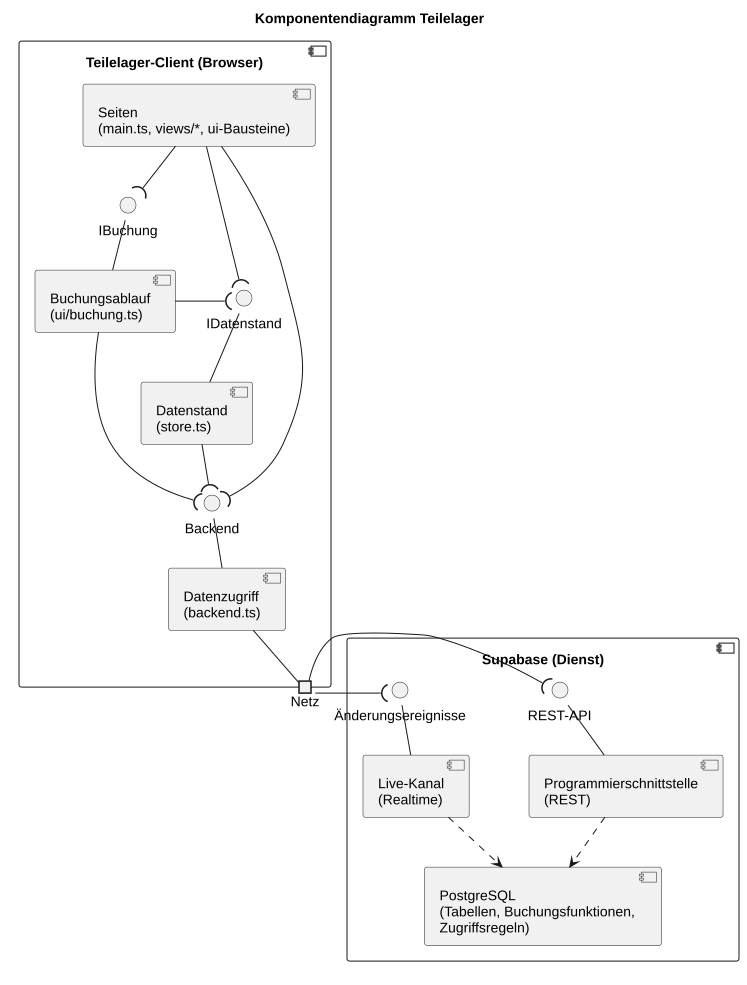
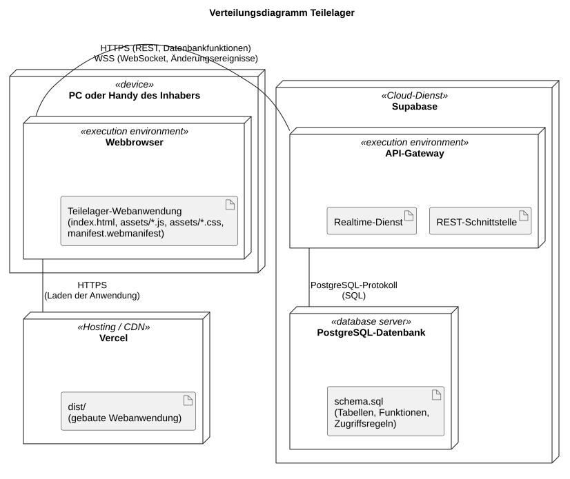
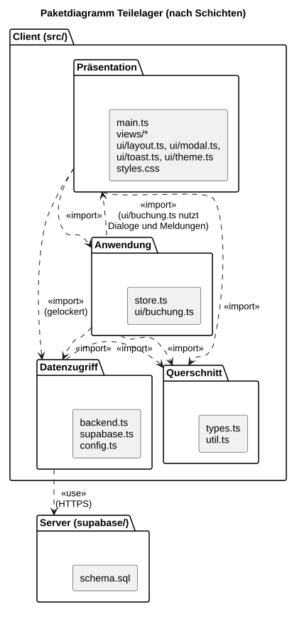

# Komponenten, Verteilung und Pakete

**Produkt:** Teilelager – Lager und Verkauf für die Werkstatt
**Stand:** 27.11.2026 (Entwurf, am Quellcode geprüft)
**Issue:** #7

Wie in der Vorlesung wird die Architektur mit drei UML-Diagrammen dokumentiert:

| Diagramm | Zeigt | Beantwortet |
|---|---|---|
| Komponentendiagramm | Komponenten, Schnittstellen, Abhängigkeiten | Woraus besteht das System? |
| Verteilungsdiagramm | Knoten, Artefakte, Kommunikationspfade | Wo läuft welche Software? |
| Paketdiagramm | Pakete und ihre Abhängigkeiten | Wie ist das Modell organisiert? |

Die Diagramme sind mit PlantUML erstellt. Quelltexte (`.puml`) und erzeugte Bilder (`.svg`) liegen in `diagramme/`. Erzeugen mit: `java -jar plantuml.jar -tsvg docs/architecture/diagramme/*.puml`.

## 1 Komponentendiagramm

**Notation** (nach den Folien):

| Element | Darstellung | Im Diagramm |
|---|---|---|
| Komponente | Rechteck mit Komponentensymbol | Seiten, Buchungsablauf, Datenstand, Datenzugriff; auf dem Server REST, Live-Kanal, PostgreSQL |
| Bereitgestellte Schnittstelle | Kreis („Lollipop“) | `IBuchung`, `IDatenstand`, `Backend`, `REST-API`, `Änderungsereignisse` |
| Benötigte Schnittstelle | Halbkreis („Socket“) | zum Beispiel benötigen die Seiten `IBuchung` und `IDatenstand` |
| Abhängigkeit | gestrichelter Pfeil vom Abhängigen zum Genutzten | REST und Live-Kanal hängen von PostgreSQL ab |
| Port | kleines Quadrat am Rand | „Netz“ am Rand des Clients: einziger Übergang zum Server |

**Komponenten**

| Komponente | Module | Verantwortlichkeit |
|---|---|---|
| Seiten | `main.ts`, `views/*`, `ui/layout.ts`, `ui/modal.ts`, `ui/toast.ts`, `ui/theme.ts` | Oberfläche, Eingaben, Seitenwechsel |
| Buchungsablauf | `ui/buchung.ts` | Ablauf von Verkauf, Zugang und Rückgängig, Warnung bei zu wenig Bestand |
| Datenstand | `store.ts` | Kategorien und Teile im Speicher, Live-Aktualisierung |
| Datenzugriff | `backend.ts`, `supabase.ts`, `config.ts` | Einheitlicher Zugriff auf Supabase oder den Demo-Modus |
| Programmierschnittstelle (REST) | Supabase | Lesen und Schreiben der Tabellen, Aufruf der Datenbankfunktionen |
| Live-Kanal (Realtime) | Supabase | Meldet Änderungen an den Tabellen |
| PostgreSQL | `supabase/schema.sql` | Tabellen, Buchungsfunktionen, Zugriffsregeln |

**Schnittstellen**

| Schnittstelle | Anbieter | Nutzer | Operationen |
|---|---|---|---|
| `IBuchung` | Buchungsablauf | Seiten | `verkaufen(teil, menge)`, `zugang(teil, menge)`, `stornierenMitMeldung(buchung)` |
| `IDatenstand` | Datenstand | Seiten, Buchungsablauf | `laden()`, `starteLive()`, `abonnieren(hoerer)`, `teil(id)`, `kategorie(id)`, `uebernehmeBuchung(buchung)`, Felder `teile`, `kategorien` |
| `Backend` | Datenzugriff | Seiten, Buchungsablauf, Datenstand | `kategorien()`, `teile()`, `buchungen(filter)`, `teilAnlegen`, `teilAendern`, `teilLoeschen`, `kategorieAnlegen`, `kategorieUmbenennen`, `kategorieLoeschen`, `buchen`, `korrigieren`, `stornieren`, `aufAenderungen(cb)` |
| `REST-API` | Supabase | Datenzugriff | Tabellen `kategorien`, `teile`, `buchungen`; Funktionen `buchen`, `korrigieren`, `stornieren` (über `POST /rest/v1/rpc/…`) |
| `Änderungsereignisse` | Supabase | Datenzugriff | Ereignis `postgres_changes` für `kategorien`, `teile`, `buchungen` |

Hinweis: `Backend` ist im Code eine echte TypeScript-Schnittstelle (`interface Backend` in `backend.ts`). `IBuchung` und `IDatenstand` sind im Code keine eigenen Typen; sie stehen für die öffentlichen Funktionen von `ui/buchung.ts` bzw. die öffentlichen Methoden des Objekts `store`.

Die Verbindung von den Seiten direkt zu `Backend` ist die bewusst gelockerte Schichtung (siehe `architekturstil.md` und `strukturen.md`).

## 2 Verteilungsdiagramm

**Knoten** (3D-Quader)

| Knoten | Art | Artefakte |
|---|---|---|
| PC oder Handy des Inhabers | Gerät (`<<device>>`) | – |
| Webbrowser | Ausführungsumgebung im Gerät | Teilelager-Webanwendung (`index.html`, `assets/*.js`, `assets/*.css`, `manifest.webmanifest`) |
| Vercel | Hosting und CDN | `dist/` (gebaute Webanwendung) |
| Supabase | Cloud-Dienst | – |
| API-Gateway | Ausführungsumgebung bei Supabase | REST-Schnittstelle, Realtime-Dienst |
| PostgreSQL-Datenbank | Datenbankserver bei Supabase | `schema.sql` (Tabellen, Funktionen, Zugriffsregeln) |

**Kommunikationspfade**

| Von | Nach | Protokoll | Zweck |
|---|---|---|---|
| Webbrowser | Vercel | HTTPS | Laden der Anwendung |
| Webbrowser | API-Gateway | HTTPS | REST-Anfragen und Aufruf der Datenbankfunktionen |
| Webbrowser | API-Gateway | WSS (WebSocket über TLS) | Empfang der Änderungsereignisse |
| API-Gateway | PostgreSQL-Datenbank | PostgreSQL-Protokoll (SQL) | Zugriff auf Tabellen und Funktionen |

Die Pfade zwischen Browser und API-Gateway sind im Diagramm zu einer Verbindung mit beiden Protokollen zusammengefasst. Die innere Aufteilung von Supabase (API-Gateway und Datenbank) folgt der Dokumentation des Dienstes; sie wird von Supabase betrieben und ist nicht Teil dieses Projekts.

## 3 Paketdiagramm

Die Pakete sind **architekturbasiert nach Schichten** gegliedert, wie in der Vorlesung als Strukturierungsprinzip genannt. Abhängigkeiten sind gestrichelte Pfeile mit `<<import>>` bzw. `<<use>>`.

| Paket | Inhalt | Nutzt |
|---|---|---|
| Präsentation | `main.ts`, `views/*`, `ui/layout.ts`, `ui/modal.ts`, `ui/toast.ts`, `ui/theme.ts`, `styles.css` | Anwendung, Datenzugriff (gelockert), Querschnitt |
| Anwendung | `store.ts`, `ui/buchung.ts` | Datenzugriff, Querschnitt, Präsentation (siehe unten) |
| Datenzugriff | `backend.ts`, `supabase.ts`, `config.ts` | Querschnitt, Server |
| Querschnitt | `types.ts`, `util.ts` | – |
| Server | `supabase/schema.sql` | – |

**Abweichung von der strikten Schichtung:** `ui/buchung.ts` (Anwendung) nutzt die Dialoge und Meldungen aus `ui/modal.ts` und `ui/toast.ts` (Präsentation). Das ist eine Abhängigkeit nach oben und im Diagramm eingezeichnet. Sie entsteht, weil der Buchungsablauf bei zu wenig Bestand selbst eine Rückfrage stellt. Nicht dargestellt ist `backup.ts`, das nicht mehr eingebunden ist (technische Schuld, siehe `architekturstil.md`).
