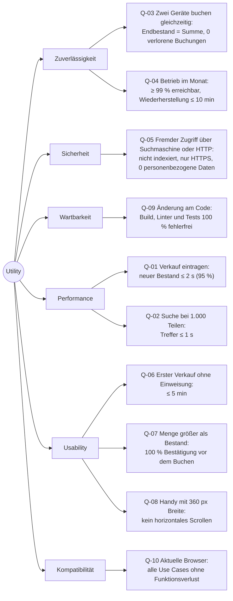

# Qualitätsszenarien und Utility Tree

**Produkt:** Teilelager – Lager und Verkauf für die Werkstatt
**Stand:** 27.11.2026 (Entwurf, noch zu prüfen)
**Issue:** #6

Die Architekturtreiber sind die Qualitätsanforderungen aus `docs/requirements/nichtfunktionale-anforderungen.md`. Wie in der Vorlesung (ATAM, Utility Tree) werden sie hier zu **messbaren Qualitätsszenarien** verfeinert. Jedes Szenario nennt den Auslöser (Stimulus), die Umgebung und eine Metrik. Die Priorität stammt aus `docs/requirements/priorisierung.md`. Die Szenarien werden in der Reihenfolge ihrer Priorität analysiert.

## 1 Utility Tree

## 2 Szenarien

| ID | Qualitätsattribut | Stimulus | Umgebung | Metrik | Priorität | Bezug |
|---|---|---|---|---|---|---|
| Q-03 | Zuverlässigkeit (Integrität) | Zwei Geräte buchen gleichzeitig auf dasselbe Teil | Normalbetrieb, beide Geräte online | Endbestand entspricht in 100 % der Fälle der Summe aller Buchungen; 0 verlorene Buchungen | Must | NFR-06 |
| Q-05 | Sicherheit (Vertraulichkeit) | Eine fremde Person sucht die Anwendung über eine Suchmaschine oder ruft sie über `http://` auf | Öffentlicher Betrieb ohne Anmeldung | Seite ist nicht indexierbar (`noindex`); Verbindung nur über HTTPS; 0 personenbezogene Daten in der Datenbank | Must | NFR-08 |
| Q-09 | Wartbarkeit (Testbarkeit, Modularität) | Ein Entwickler ändert den Code und öffnet einen Pull Request | Entwicklung | `npm run build`, Linter und automatisierte Tests laufen zu 100 % fehlerfrei | Must | NFR-09 |
| Q-01 | Performance (Zeitverhalten) | Der Inhaber trägt einen Verkauf, eine Lieferung oder eine Korrektur ein | Normale Internetverbindung | Neuer Bestand ist bei 95 % von 20 Buchungen nach ≤ 2 s sichtbar | Should | NFR-01 |
| Q-02 | Performance (Zeitverhalten) | Der Inhaber tippt einen Suchbegriff ein | Lager mit 1.000 Teilen | Treffer erscheinen nach ≤ 1 s | Should | NFR-02 |
| Q-06 | Usability (Erlernbarkeit) | Der Inhaber nutzt das Programm zum ersten Mal | Ohne Einweisung | Erster Verkauf (UC-01) ist nach ≤ 5 min gebucht | Should | NFR-03 |
| Q-07 | Usability (Schutz vor Fehlbedienung) | Der Inhaber gibt eine Menge größer als den Bestand ein | Verkauf oder Wegnehmen | In 100 % der Fälle Bestätigung vor dem Buchen; Menge ≤ 0 wird in 100 % der Fälle abgelehnt | Should | NFR-04 |
| Q-08 | Usability (Bedienbarkeit) | Der Inhaber öffnet das Programm auf dem Handy | Bildschirmbreite 360 px | Kein horizontales Scrollen auf allen Seiten | Should | NFR-05 |
| Q-10 | Kompatibilität | Der Inhaber nutzt einen anderen Browser | Aktuelle Versionen von Chrome, Edge, Firefox, Safari | UC-01 bis UC-06 ohne Funktionsverlust | Should | NFR-10 |
| Q-04 | Zuverlässigkeit (Verfügbarkeit) | Die Datenbank pausiert oder fällt aus | Kostenloser Tarif (RB-02) | Erreichbarkeit ≥ 99 % im Monat; Wiederherstellung nach Pause ≤ 10 min (MTTR) | Could | NFR-07 |

Die Szenarien Q-03 und Q-01 betreffen das Buchen und den Bestand. Sie sind die wichtigsten Treiber für den Entwurf mit Attribute-Driven Design (siehe `architekturstil.md`).

## 3 Analyse der wichtigsten Entscheidungen (ATAM, Kurzform)

Wie in der Vorlesung wird jede Entscheidung bezogen auf ein Szenario in vier Kategorien eingeordnet: Sensitivitätspunkt, Trade-off, Risiko und Non-Risk.

### Szenario Q-03: Zwei Geräte buchen gleichzeitig

Entscheidung: **Bestandsregeln als Datenbankfunktionen** (`buchen`, `korrigieren`, `stornieren`) **statt Berechnung des Bestands im Client**

| Kategorie | Aussage |
|---|---|
| Sensitivitätspunkt | Wo der Bestand berechnet wird, bestimmt die Integrität: Rechnet jeder Client selbst und schreibt das Ergebnis zurück, überschreibt eine Buchung die andere. |
| Trade-off | Regeln in der Datenbank sichern die Integrität, verteilen die Logik aber auf zwei Orte (Client für Warnungen, Datenbank für Bestandsregeln) und erschweren das Testen. |
| Risiko | Wird der Bestand doch an einer Stelle direkt geschrieben, gehen Buchungen verloren. Abhilfe: Die Zugriffsregeln erlauben kein direktes Schreiben des Bestands. |
| Non-Risk | Bei einem Nutzer mit wenigen Buchungen pro Minute ist die Sperre einer Zeile während einer Buchung für die Antwortzeit unkritisch. |

### Szenario Q-02: Suche bei 1.000 Teilen

Entscheidung: **Alle Teile im Client halten und dort durchsuchen statt Suche auf dem Server**

| Kategorie | Aussage |
|---|---|
| Sensitivitätspunkt | Ob die Suche lokal oder auf dem Server läuft, bestimmt die Antwortzeit beim Tippen. |
| Trade-off | Lokale Suche ist sofort und ohne Netz möglich, kostet aber Ladezeit und Speicher beim Start. |
| Risiko | Wächst das Lager weit über 1.000 Teile, werden Start und Speicherbedarf zum Problem. |
| Non-Risk | Bei rund 500 Teilen (Angabe des Auftraggebers) ist die Datenmenge klein. |
