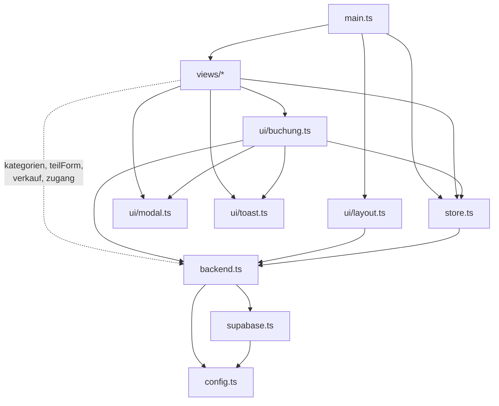

# Strukturen

**Produkt:** Teilelager – Lager und Verkauf für die Werkstatt
**Stand:** 27.11.2026 (Entwurf, am Quellcode geprüft)
**Issue:** #6

Wie in der Vorlesung wird die Architektur über drei Arten von Strukturen beschrieben: **Modulstrukturen** (statisch: wer ist wofür verantwortlich?), **dynamische Strukturen** (Laufzeit: wer interagiert wie mit wem?) und **Allokationsstrukturen** (Umgebung: wo läuft was, wer entwickelt was?). Alle Angaben sind am Quellcode in `src/` und an `supabase/schema.sql` geprüft.

## 1 Modulstrukturen

### 1.1 Funktionale Zerlegung

| Funktionsbereich | Teilfunktion | Modul |
|---|---|---|
| Lager | Übersicht mit Suche und leeren Teilen | `views/uebersicht.ts` |
| | Lagerliste mit Filtern | `views/lagerliste.ts` |
| | Bestand ändern (Zugang, Wegnehmen, Korrektur) | `views/zugang.ts` |
| | Teil anlegen, ändern, löschen | `views/teilForm.ts` |
| | Kategorien verwalten | `views/kategorien.ts` |
| Verkauf | Verkauf erfassen, Verkäufe auswerten, Rückgängig | `views/verkauf.ts` |
| Gemeinsam | Buchungsablauf (Verkauf, Zugang, Rückgängig) | `ui/buchung.ts` |
| | Datenstand und Live-Aktualisierung | `store.ts` |
| | Datenzugriff (Supabase oder Demo) | `backend.ts` |
| | Bestandsregeln und Datenhaltung | `supabase/schema.sql` |

### 1.2 Uses-Struktur (Modul A nutzt Modul B)

Ermittelt aus den `import`-Anweisungen im Quellcode. Die querschnittlichen Module `types.ts` und `util.ts` sind der Übersicht halber weggelassen.

Gestrichelt: direkte Zugriffe von Seiten auf die Datenzugriffsschicht (gelockerte Schichtung). `ui/layout.ts` nutzt `backend.ts` nur, um den Demo-Modus anzuzeigen.

**Zugriffe der Seiten auf die Daten**

| Zugriff | Weg |
|---|---|
| Kategorien und Teile lesen | über den Datenstand in `store.ts` |
| Verkäufe lesen (Verkaufsübersicht) | direkt über `backend.buchungen` aus `views/verkauf.ts`, gefiltert nach Zeitraum |
| Verkauf, Zugang, Rückgängig | über `ui/buchung.ts` zu `backend.buchen` bzw. `backend.stornieren` |
| Bestand korrigieren und wegnehmen | direkt über `backend.korrigieren` aus `views/zugang.ts` und `views/teilForm.ts` |
| Teile und Kategorien anlegen, ändern, löschen | direkt über `backend` aus `views/teilForm.ts` und `views/kategorien.ts` |

### 1.3 Schichtenstruktur

| Schicht | Module |
|---|---|
| Präsentation | `main.ts`, `views/*`, `ui/layout.ts`, `ui/modal.ts`, `ui/toast.ts`, `ui/theme.ts`, `styles.css` |
| Anwendung | `store.ts`, `ui/buchung.ts` |
| Datenzugriff | `backend.ts`, `supabase.ts`, `config.ts` |
| Datenhaltung (Server) | `supabase/schema.sql` (Tabellen, Buchungsfunktionen, Zugriffsregeln) |
| Querschnitt | `types.ts`, `util.ts` |

Herleitung und Begründung der Schichten stehen in `architekturstil.md`.

### 1.4 Generalisierung und Spezialisierung

| Abstraktion | Spezialisierungen | Zweck |
|---|---|---|
| Schnittstelle `Backend` (`backend.ts`) | `supabaseBackend` (echter Betrieb), `createDemoBackend()` (Daten im Browser) | Die übrigen Module kennen nur die Schnittstelle; welche Umsetzung genutzt wird, entscheidet `istDemoModus` beim Start. |
| Schnittstelle `View` (`types.ts`) mit `mount`, `update`, `unmount` | jede Seite in `views/*` | `main.ts` behandelt alle Seiten gleich: einhängen, bei Datenänderungen aktualisieren, beim Verlassen aufräumen. |

## 2 Dynamische Strukturen

### 2.1 Zustand

| Element | Zustand | Begründung |
|---|---|---|
| Client (`store.ts`) | zustandsbehaftet | hält Kategorien und Teile im Speicher, solange die Seite offen ist |
| Demo-Modus | zustandsbehaftet | speichert die Daten im `localStorage` des Browsers |
| Anfragen an Supabase (REST) | zustandslos | jede Anfrage enthält alles Nötige; der Server merkt sich nichts zwischen Anfragen |
| Live-Kanal (Realtime) | zustandsbehaftet | dauerhafte Verbindung, über die der Server Änderungen meldet |
| Datenbank | zustandsbehaftet | dauerhafte Speicherung von Kategorien, Teilen und Verkäufen |

### 2.2 Datenfluss am Beispiel „Verkauf erfassen“ (UC-01)

1. Die Seite nimmt Teil und Menge entgegen.
2. `ui/buchung.ts` prüft die Menge und fragt bei zu wenig Bestand nach.
3. `backend.buchen` ruft die Datenbankfunktion `buchen` über HTTPS auf.
4. Die Datenbank ändert den Bestand, speichert den Verkauf und liefert die Buchung mit dem neuen Bestand zurück.
5. `store.uebernehmeBuchung` setzt den neuen Bestand im Datenstand und benachrichtigt die Seite, die sich neu zeichnet.
6. Parallel meldet der Live-Kanal die Änderung an alle verbundenen Clients. Diese laden die Teile nach.

### 2.3 Synchrone und asynchrone Kommunikation

| Kommunikation | Art | Beschreibung |
|---|---|---|
| Client → Supabase (Lesen, Buchen) | synchron im Ablauf | Die Anfrage läuft im Browser nicht blockierend (Promise), der Ablauf wartet aber auf die Antwort, bevor er den neuen Bestand anzeigt. |
| Supabase → Client (Änderungsereignisse) | asynchron | Der Server meldet Änderungen, sobald sie geschehen; der Client wartet nicht darauf. |
| Nachladen nach Ereignissen | asynchron, gebündelt | Ereignisse innerhalb von 150 ms werden zu einem Nachladen zusammengefasst. |
| Zwischen Browser-Tabs im Demo-Modus | asynchron | `BroadcastChannel` meldet Änderungen an andere Tabs. |

### 2.4 Laufzeitabhängigkeiten

| Abhängigkeit | Folge im Betrieb | Umgang |
|---|---|---|
| Erreichbarkeit von Supabase | Ohne Datenbank kann das Programm beim Start keine Daten laden | `main.ts` zeigt „Fehler beim Laden“ mit einem Knopf zum Neuladen |
| Pause der Datenbank im kostenlosen Tarif | Nach etwa 7 Tagen ohne Nutzung ist die Datenbank nicht erreichbar | Wiederherstellung über das Supabase-Dashboard (Q-04, RB-02) |
| Verlust der Internetverbindung | Änderungen anderer Geräte kommen nicht an | Nach Wiederverbindung oder beim Zurückkehren in den Tab lädt `store.ts` alles neu |
| Erreichbarkeit von Vercel | Ohne Hosting lässt sich die Anwendung nicht öffnen | keine eigene Maßnahme (Q-04) |

### 2.5 Nebenläufigkeit und Synchronisation

Kritisch ist die gleichzeitige Buchung von zwei Geräten auf dasselbe Teil (Q-03). Ohne Synchronisation entstünde ein **verlorenes Update durch eine Race Condition**, wie im Beispiel der Vorlesung:

| Schritt | Gerät A (Verkauf 2 Stück) | Gerät B (Verkauf 1 Stück) | Bestand |
|---|---|---|---|
| 1 | liest Bestand 10 | – | 10 |
| 2 | – | liest Bestand 10 | 10 |
| 3 | schreibt 8 | – | 8 |
| 4 | – | schreibt 9 | 9 |

Erwartet wäre ein Bestand von 7; der Verkauf von Gerät A wäre verloren.

**Umsetzung in Teilelager:** Die Clients berechnen den Bestand nicht selbst. Die Datenbankfunktion `buchen` ändert ihn mit `update teile set bestand = bestand + delta`. PostgreSQL sperrt dabei die Zeile des Teils (Zeilen-Lock); die zweite Buchung wartet, bis die erste abgeschlossen ist, und rechnet dann mit dem aktuellen Wert:

| Schritt | Gerät A (Verkauf 2 Stück) | Gerät B (Verkauf 1 Stück) | Bestand |
|---|---|---|---|
| 1 | `buchen`: sperrt die Zeile, setzt 10 − 2 | wartet auf die Sperre | 8 |
| 2 | gibt die Sperre frei | `buchen`: sperrt die Zeile, setzt 8 − 1 | 7 |

`korrigieren` liest den alten Bestand mit `select … for update` und sperrt die Zeile damit ebenfalls. `stornieren` sperrt die zurückzunehmende Buchung mit `for update`, damit sie nicht zweimal rückgängig gemacht wird. Die Zugriffsregeln verbieten, den Bestand direkt zu schreiben.

**Deadlocks:** `buchen` und `korrigieren` sperren nur die Zeile eines Teils. `stornieren` sperrt erst die Buchung und dann das Teil; keine andere Funktion hält dabei eine Buchung gesperrt, die sie anschließend braucht. Ein zirkuläres Warten zwischen den Funktionen ist damit nicht zu erwarten. Sollte es dennoch auftreten, erkennt PostgreSQL den Deadlock und bricht eine der Transaktionen ab.

**Nebenläufigkeit im Client:**
- Während eine Bestandsänderung oder ein Teil gespeichert wird, sind die Knöpfe gesperrt; ein doppelter Klick löst keine zweite Speicherung aus (`views/zugang.ts`, `views/teilForm.ts`).
- Kommt eine Änderung herein, während der Inhaber in ein Mengenfeld tippt, wird die Seite erst nach dem Verlassen des Feldes neu gezeichnet (`main.ts`). So gehen keine Eingaben verloren.

## 3 Allokationsstrukturen

### 3.1 Deployment (Artefakte → Rechenknoten)

| Artefakt | Rechenknoten |
|---|---|
| Gebaute Webanwendung `dist/` (`index.html`, JavaScript- und CSS-Dateien, Manifest, App-Symbole) | Hosting bei Vercel; ausgeführt im Browser auf PC oder Handy des Inhabers |
| Datenbankschema `supabase/schema.sql` (Tabellen, Funktionen, Zugriffsregeln) | PostgreSQL-Datenbank bei Supabase |

Die Kommunikationspfade mit Protokollen zeigt das Verteilungsdiagramm in `komponenten.md`.

### 3.2 Arbeitszuteilung

**Artefakte → Dateien und Verzeichnisse**

| Verzeichnis | Inhalt |
|---|---|
| `src/views/` | Seiten |
| `src/ui/` | Bausteine der Oberfläche und Buchungsablauf |
| `src/` | Datenstand, Datenzugriff, Konfiguration, Typen, Hilfsfunktionen |
| `supabase/` | Datenbankschema |
| `public/` | Manifest und App-Symbole |
| `docs/` | Projektdokumentation |
| `tests/` | automatisierte Tests |

**Module → Personen:** Das Projekt wird von einer Person bearbeitet (Projektaufgabe als Einzelarbeit). Alle Module, die Dokumentation und die Tests liegen in ihrer Verantwortung.
