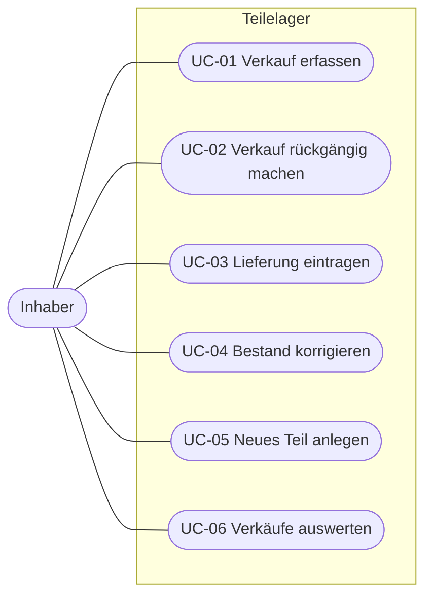

# Use Cases

**Produkt:** Teilelager – Lager und Verkauf für die Werkstatt
**Stand:** 25.11.2026 (Entwurf, noch zu prüfen)
**Akteur:** Inhaber (Rolle `R-01`, siehe `stakeholder.md`)

Die Use Cases beschreiben zentrale Abläufe des Systems in der Vorlage aus dem Kurs: Name/ID, Akteure, Auslöser, Vorbedingungen, Nachbedingungen, Hauptszenario, Alternativen und Priorität/Häufigkeit. Sie bauen auf den User Stories in `user-stories.md` auf. Alternativszenarien sind nach dem Schritt nummeriert, an dem sie abweichen (zum Beispiel 3a).

## 1 Use-Case-Diagramm

## 2 Übersicht

| ID | Use Case | Basiert auf User Stories |
|---|---|---|
| UC-01 | Verkauf erfassen | US-10, US-11 |
| UC-02 | Verkauf rückgängig machen | US-12 |
| UC-03 | Lieferung eintragen | US-05 |
| UC-04 | Bestand korrigieren | US-06 |
| UC-05 | Neues Teil anlegen | US-01 |
| UC-06 | Verkäufe auswerten | US-13 |

Die Angabe zur Häufigkeit ist eine Annahme und noch mit dem Auftraggeber zu bestätigen. Die endgültige Priorität folgt in `priorisierung.md`.

---

## UC-01 Verkauf erfassen

| Feld | Beschreibung |
|---|---|
| Name / ID | UC-01 Verkauf erfassen |
| Akteure | Inhaber |
| Auslöser | Der Inhaber hat ein Teil verkauft und möchte den Verkauf festhalten. |
| Vorbedingungen | Das Teil ist im Lager angelegt. |
| Nachbedingungen | Der Verkauf ist mit Datum und Uhrzeit gespeichert, der Bestand des Teils ist um die verkaufte Menge verringert. |
| Priorität / Häufigkeit | Hoch / mehrfach pro Tag (Annahme) |

**Hauptszenario**
1. Der Inhaber öffnet den Bereich „Verkauf“.
2. Er sucht das Teil über das Suchfeld (Name, Artikelnummer, …) und wählt den Treffer aus.
3. Er gibt die verkaufte Menge ein.
4. Er wählt „Verkauf eintragen“.
5. Das System prüft, dass die Menge größer als 0 ist und der Bestand ausreicht.
6. Das System speichert den Verkauf und verringert den Bestand.
7. Der Verkauf erscheint in der Verkaufsübersicht.

**Alternativen**
- 3a Die Menge ist 0: Das System meldet „Bitte eine Menge größer als 0 eingeben.“ und der Ablauf geht zurück zu Schritt 3.
- 5a Die Menge ist größer als der Bestand: Das System warnt („Nicht genug auf Lager“) und nennt den Bestand, der sich danach ergibt.
  - 5a1 Der Inhaber wählt „Trotzdem verkaufen“: Der Ablauf geht mit Schritt 6 weiter, der Bestand wird negativ und als „Im Minus“ hervorgehoben.
  - 5a2 Der Inhaber bricht ab: Es wird nichts gebucht.
- 6a Das Speichern schlägt fehl: Das System zeigt eine Fehlermeldung, es wird nichts gebucht.
- *Variante:* Der Verkauf kann auch direkt in der Lagerliste über „−“ eingetragen werden. Die Schritte ab 5 sind identisch.

---

## UC-02 Verkauf rückgängig machen

| Feld | Beschreibung |
|---|---|
| Name / ID | UC-02 Verkauf rückgängig machen |
| Akteure | Inhaber |
| Auslöser | Der Inhaber hat einen Verkauf falsch eingetragen. |
| Vorbedingungen | Der Verkauf existiert und wurde noch nicht rückgängig gemacht. |
| Nachbedingungen | Der Verkauf ist als rückgängig gekennzeichnet, eine Gegenbuchung ist angelegt und der Bestand ist wieder um die verkaufte Menge erhöht. Der ursprüngliche Verkauf wird nicht gelöscht. |
| Priorität / Häufigkeit | Mittel / selten (Annahme) |

**Hauptszenario**
1. Der Inhaber öffnet den Bereich „Verkauf“ und wählt gegebenenfalls einen Zeitraum.
2. Er sucht in der Liste „Einzelne Verkäufe“ den falschen Verkauf.
3. Er wählt bei diesem Verkauf „Rückgängig“.
4. Das System fragt nach („Buchung rückgängig machen?“).
5. Der Inhaber bestätigt mit „Rückgängig machen“.
6. Das System legt die Gegenbuchung an und erhöht den Bestand.
7. Das System meldet „Rückgängig gemacht.“

**Alternativen**
- 5a Der Inhaber bricht ab: Es ändert sich nichts.
- 6a Der Verkauf wurde schon rückgängig gemacht: Das System meldet einen Fehler und ändert nichts.
- 6b Das Speichern schlägt fehl: Das System zeigt eine Fehlermeldung, der Bestand bleibt unverändert.

---

## UC-03 Lieferung eintragen

| Feld | Beschreibung |
|---|---|
| Name / ID | UC-03 Lieferung eintragen |
| Akteure | Inhaber |
| Auslöser | Eine Lieferung ist eingetroffen. |
| Vorbedingungen | Das Teil ist im Lager angelegt. |
| Nachbedingungen | Der Bestand des Teils ist um die gelieferte Menge erhöht. |
| Priorität / Häufigkeit | Hoch / mehrmals pro Woche (Annahme) |

**Hauptszenario**
1. Der Inhaber öffnet „Lager“ und dort „Bestand ändern“.
2. Er sucht das Teil und wählt es aus.
3. Er gibt unter „Wie viele?“ die gelieferte Menge ein.
4. Er wählt „Hinzufügen“.
5. Das System erhöht den Bestand.
6. Das System zeigt den neuen Bestand deutlich an, mit dem Hinweis, wie viele hinzugefügt wurden.

**Alternativen**
- 4a Die Menge ist 0: Das System meldet „Bitte eine Menge größer als 0 eingeben.“ und der Ablauf geht zurück zu Schritt 3.
- 6a Das Speichern schlägt fehl: Das System zeigt eine Fehlermeldung, der Bestand bleibt unverändert.
- *Variante:* Die Lieferung kann auch direkt in der Lagerliste über „+“ eingetragen werden.

---

## UC-04 Bestand korrigieren

| Feld | Beschreibung |
|---|---|
| Name / ID | UC-04 Bestand korrigieren |
| Akteure | Inhaber |
| Auslöser | Der Inhaber hat nachgezählt und der angezeigte Bestand stimmt nicht. |
| Vorbedingungen | Das Teil ist im Lager angelegt. |
| Nachbedingungen | Der Bestand des Teils entspricht dem gezählten Wert. |
| Priorität / Häufigkeit | Mittel / gelegentlich (Annahme) |

**Hauptszenario**
1. Der Inhaber öffnet „Lager“ und dort „Bestand ändern“.
2. Er sucht das Teil und wählt es aus.
3. Er trägt unter „Zahl stimmt nicht? Bestand direkt eintragen“ den richtigen Bestand ein.
4. Er wählt „Speichern“.
5. Das System setzt den Bestand auf den eingegebenen Wert.
6. Das System meldet, auf welchen Wert der Bestand geändert wurde.

**Alternativen**
- 4a Das Feld ist leer: Das System meldet „Bitte die gezählte Menge eingeben.“ und der Ablauf geht zurück zu Schritt 3.
- 5a Der eingegebene Wert entspricht dem aktuellen Bestand: Das System meldet, dass der Bestand schon stimmt und nichts geändert wurde.
- *Variante:* Der Inhaber kann Teile über „Wegnehmen“ aus dem Bestand nehmen, ohne dass dies als Verkauf zählt. Ist die Menge größer als der Bestand, warnt das System („Trotzdem wegnehmen?“).

---

## UC-05 Neues Teil anlegen

| Feld | Beschreibung |
|---|---|
| Name / ID | UC-05 Neues Teil anlegen |
| Akteure | Inhaber |
| Auslöser | Der Inhaber möchte ein neues Teil im Lager führen. |
| Vorbedingungen | Mindestens eine Kategorie ist angelegt. |
| Nachbedingungen | Das Teil ist mit seinen Angaben gespeichert und in der Lagerliste sichtbar. |
| Priorität / Häufigkeit | Hoch / zu Beginn oft, später gelegentlich (Annahme) |

**Hauptszenario**
1. Der Inhaber öffnet „Lager“ und dort „Neues Teil“.
2. Er wählt eine Kategorie. Die weiteren Felder passen sich der Vorlage der Kategorie an (Standard, Öl, Filter oder Reifen).
3. Er trägt die Bezeichnung und die gewünschten weiteren Angaben ein (zum Beispiel Artikelnummer, Lieferant, Lagerort, passende Fahrzeuge, Einheit).
4. Er speichert das Teil.
5. Das System prüft die Pflichtangaben und speichert das Teil.
6. Das Teil erscheint in der Lagerliste.

**Alternativen**
- 1a Es ist noch keine Kategorie vorhanden: Das System weist darauf hin, zuerst eine Kategorie anzulegen, und verweist auf die Kategorien.
- 5a Eine Pflichtangabe fehlt: Das System meldet den Fehler und der Ablauf geht zurück zu Schritt 3.
- 5b Ein gleiches Teil existiert schon: Das System warnt.
- *Variante:* Mit „Speichern und nächstes Teil“ legt der Inhaber mehrere Teile hintereinander an.

---

## UC-06 Verkäufe auswerten

| Feld | Beschreibung |
|---|---|
| Name / ID | UC-06 Verkäufe auswerten |
| Akteure | Inhaber |
| Auslöser | Der Inhaber möchte wissen, was in einem Zeitraum verkauft wurde. |
| Vorbedingungen | Keine. Ohne Verkäufe zeigt das System einen entsprechenden Hinweis. |
| Nachbedingungen | Keine Änderung am System, die Daten werden nur angezeigt. |
| Priorität / Häufigkeit | Mittel / gelegentlich (Annahme) |

**Hauptszenario**
1. Der Inhaber öffnet den Bereich „Verkauf“.
2. Er wählt einen Zeitraum: heute, diese Woche, diesen Monat oder einen eigenen Zeitraum.
3. Das System zeigt die Anzahl der verkauften Teile, die am meisten verkauften Teile, die Verkäufe nach Teil und die einzelnen Verkäufe im gewählten Zeitraum.

**Alternativen**
- 3a Im Zeitraum gibt es keine Verkäufe: Das System zeigt „Keine Verkäufe in diesem Zeitraum.“

---

## Offene Punkte (vom Nutzer zu klären)
- Stimmen die Abläufe mit der Arbeit in der Werkstatt überein, und sind die Häufigkeiten realistisch?
- Fehlen wichtige Abläufe (zum Beispiel Kategorien verwalten oder Teil suchen), die als eigener Use Case beschrieben werden sollen?
